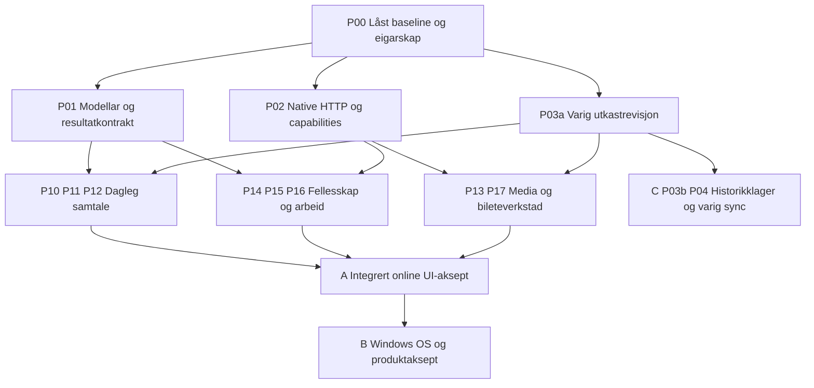

# Plan for funksjonsparitet mellom Windows og Canary

Dato: 3. november 2026. Planansvarleg: Astra. Gjennomføring er starta med
første fundamentpulje; sjå [implementasjonsstatus og prøver](native-parity-implementation-status.md).

Windows-klienten skal bli ein fullverdig native klient for funksjonane som brukaren faktisk møter i Canary. Første leveranse er Windows; Android skal seinare bruke dei same domene-, økt-, leverings- og synkkontraktane. Arbeidet byggjer vidare på den eksisterande WinUI-piloten, med avgrensa ombygging av eigarskap før fleire agentar implementerer funksjonar parallelt.

Den største utfordringa er ikkje å teikne fleire skjermbilete. Dagens pilot manglar store delar av domenemodellen i klienten, native autorisasjon til mange HTTP-funksjonar og eit produktlager for historikk og fullstendige utkast. Ei realistisk gjennomføring må levere desse kontraktane saman med brukarflatene.

Les planen saman med [statuskartlegginga](native-client-status-2026-11-03.md), [paritetsmatrisa](native-canary-parity-matrix.md), [Windows Canary-kontrakten](native-windows-canary.md), [identitetsavgjerda](native-client-identity-adr.md) og [synkroniseringsavgjerda](native-client-sync-adr.md).

## Referanse og avgrensing

Canary-referansen er serverrevisjon `142f71888cdde11dec42a698432530e208f577bb`, stadfesta gjennom offentleg `/versionz` og køyrande utrulling 3. november. App-imaget er `sha256:973fd0e10ba09d897c2fdefb57c2f21ab255a2ad9e091e2fd4e52a075c56356a`; GitOps-revisjonen er `79f28a8b0247ad7eb633fdf6da7aa945000fb532`. Native og samtaleagentane er aktiverte i dette miljøet. Desse observasjonane seier at tenestene er tilgjengelege, ikkje at kvar brukarhandling er akseptert.

Arbeidskopien står på `8715726e9fe11290f215a13cbc71261993942313` og har urelaterte lokale endringar i autentisering og familieappar. Implementasjonen skal starte frå ein isolert arbeidskopi med avtalt grunnrevisjon. Ingen skal rydde, flytte eller ta med dei urelaterte endringane. Avvik mellom arbeidskopien og Canary omfattar mellom anna panelstorleik, mediegestar, delingsmottak og bileteverkstaden; desse er med i paritetsmatrisa.

Opprett separate worktrees og `codex/`-grener frå den avtalte reine commiten. Ikkje bruk stash, clean eller ein PR frå den endra arbeidskopien som snarveg. Kvar agent/byggjobb får eige artefaktområde og eigne managed mellomfiler; to jobbar skal ikkje skrive same native/probe-output, lokal testprofil eller publiseringsmappe.

**Funksjonsparitet tyder same brukarutfall, tilgangsreglar og data**, med native presentasjon og plattformhandlingar. Det krev ikkje lik DOM, same dialogstruktur eller identiske pikslar. Til dømes skal native deling gi same tryggleik for konto, mål og utkast som web sitt delingsmottak, sjølv om Windows bruker ei anna systemintegrering.

Endeleg omfang er alle synlege og tilgjengelege handlingar i den låste Canary-referansen, med rett rolle og funksjonsflagg. [PAR-001–PAR-036](native-canary-parity-matrix.md) er kontrollista. Ho omfattar dagleg chat, administrasjon, agentar, prosessar, biletegenerering og relevante plattformfunksjonar. Ei funksjon som er skjult eller deaktivert i den aktuelle referansen, skal registrerast med grunnen; eit eksisterande, skjult API er ikkje automatisk eit nytt produktkrav. Generelt fulltekstsøk i meldingar blir ikkje lagt til som eit oppdikta paritetskrav.

Prioritet bestemmer rekkjefølgja, ikkje kva som stille fell ut av sluttmålet. Ei lenkje til nettappen er ein nyttig mellombels reserve, men blir merka **webreserve**, aldri **native fullført**. Ukjende kort skal gi forståeleg tekst og presis reservehandling; dei skal ikkje forsvinne eller bli viste som ferdig handsama.

Windows er einaste plattform med full UI-leveranse i denne planen. Android får eit kontrakt- og bindingsgrunnlag og ei etterfølgjande eiga leveranse. iOS, macOS og Linux blir ikkje rekna som parallelle fullprodukt. Produksjonsaktivering, nye recovery-funksjonar og endringar i Authentik er eigne leveransar dersom dei blir nødvendige; dei er ikkje vilkår for å teikne Windows-innstillingar.

Tre godkjenningar skal haldast frå kvarandre:

| Spor | Kva merkelappen krev | Kva han ikkje påstår |
| --- | --- | --- |
| A Online UI-paritet | Alle relevante brukarfunksjonar i den låste Canary-referansen, inklusive native handlingar, korrekt autorisasjon/konto/sending og feilhandtering. Avtalt driftstilstand ved nettbrot er sann og bevarer utkast/kø. | Full historikk tilgjengeleg offline, varig deltasynk eller ferdig distribusjon på alle plattformar. |
| B Windows-produkt og OS | Fysisk tilgjenge/livsløp, pakking, oppdatering og dei faktisk avtalte Windows-handlingane for varsling, lenkjer og deling. Paritetsrader for desse funksjonane blir førte særskilt. | At ny push-infrastruktur eller andre native tillegg alt fanst i Canary og difor automatisk er førekrav for A. |
| C Utvida offline | Produktlager for historikk og full N05-reparasjon med snapshot/delta, reset og tilgangstap. | At A må vente på ein ny serverjournal når den same online-funksjonen kan leverast korrekt utan han. |

Ei erklæring om «full Windows-klient» må oppgi A/B/C-status, ikkje skjule attståande OS- eller offlinearbeid. A kan godkjennast før C. Dei konkrete tryggleiks- og utkastrettingane i P01/P03 er likevel nødvendige for A; dei blir ikkje utsette som eit generelt offlineprosjekt. Eksisterande synlege varslingspreferansar høyrer til A, medan val og drift av ein eventuell ny native push-provider blir eit avgrensa B-arbeid.

Nokre PAR-rader har både A- og B-del: delingsmottaket si målveljing og utkast-/sendesikring er A, medan faktisk Windows Share-aktivering er B. Den samla rada er ikkje fullført før begge delane er aksepterte. Same skilje gjeld appnavigasjon til ein varslingsdestinasjon og faktisk levering av eit OS-varsel. Dette avgrensar milepælar utan å fjerne funksjonar frå sluttmålet.

## Utgangspunktet og dei første rettingane

Piloten bruker C# med Microsoft.UI.Reactor `0.1.0-preview.16`, ekte WinUI 3, Windows App SDK `2.2.0` og .NET SDK `10.0.301`. Kjelda ligg i [native/probes/windows-reactor](../native/probes/windows-reactor/). Han har ekte Canary-innlogging, kontoavgrensa utkast og sendekø, kanalar, siste historikk, tekstsending i kode og autorisert lesing av media. ARM64 og x64 har ulike dokumenterte prøvebevis; desse må vidareførast utan å bli kalla universell plattformaksept.

Tre grunnproblem må rettast før breiare dagleg bruk:

1. [NativeChatClient](../native/session-client/NativeChatClient.cs) gjer serveravslag til ein generell exception, medan [LiveApplication](../native/probes/windows-reactor/Core/LiveApplication.cs) handsamar alle sendefeil som uviss levering. Endeleg avvising må bli ein eigen tilstand som ikkje automatisk blir prøvd igjen. Nettbrot, tapt kvittering, behov for innlogging og endeleg domeneavslag må ha ulike utfall.
2. [Prøvelageret](../native/probes/client-core/src/store.rs) lagrar ikkje varig forventa utkast-revisjon. Eit nyare utkast med same tekst kan bli rydda av eit gammalt retry-forsøk ved hard prosessdød. Produktlageret må ha atomisk opptak med revisjonskontroll; UI-reparasjon i minnet er ikkje nok.
3. Native meldings- og kanalmodellar tek ikkje vare på mellom anna foreldretråd, redigering/sletting, roller og lesemarkørar. Dette må vere tydeleg modellert før klienten får handlingar for trådar, tilgang og innboks.

Live-historikken er ei minneprojeksjon med recent-history-lasting; ho er ikkje ein varig historikkdatabase. Grensene på åtte utkast/køelement og 1024 UTF-8-byte kjem frå prøva. Dei skal erstattast med avtalte produktgrenser, bytebudsjett og paginering, ikkje berre aukast til store vilkårlege tal.

Historisk live-aksept viser innlogging, loopback-retur, kanal/historikk, utkast, fornying og eigne medieprøver. Dei siterte kvitteringane viser ingen faktisk posta chatmelding. Ny aksept må difor bevise reell sending og feilsituasjonane på den eksakte klient/server-kombinasjonen som skal leverast.

## Brukarforløpa som styrer leveransen

Kvar flyt skal prøvast både som vellukka handling og med avbrot, feil eller manglande tilgang. Native og web skal gje same varige utfall på den same testkontoen.

| Flyt | Konkret sluttutfall |
| --- | --- |
| Inn i rett samtale | Innlogging eller invitasjon, synleg rett konto, rett krets/kanal og rett melding eller tråd; kald oppstart og eksisterande vindauge fungerer. |
| Dagleg samtale | Finn kanal eller DM, les ulest og eldre historikk, skriv med omtale/emoji, send og sjå rett kvittering; bytt samtale og kom tilbake utan tap av utkast eller leseposisjon. |
| Følg opp ei melding | Opne tråd, svar, reager, rediger eller slett med rett rolle; andre klientar ser same tilstand, og sletting kan ikkje bli omgjord av eit gammalt history-svar. |
| Del noko frå Windows | Motta fil/tekst frå systemet eller vel/lim inn vedlegg; vel konto og mål, sjå framdrift, avbryt eller prøv igjen; sending skjer berre etter brukarhandling og til opphavleg valt mål. |
| Arbeid frå innboksen | Skil uleste samtalar, omtalar og personlege oppgåver, opne kjelda og gå tilbake; lesestatus og oppgåvestatus blir stadfesta av serveren. |
| Administrer fellesskapet | Finn/opprett krets, kanal eller DM, handter medlemmer og invitasjonar, og endre oppsett med rett rolle; feil bevarer skjema og forklarer kva som ikkje vart lagra. |
| Bruk agentar og prosessar | Konfigurer tilgjengelege agentfunksjonar, les og utfør kort-/prosesshandlingar i rett ressurs, og sjå status og resultat utan nettlesarreserve for fullførte paritetsrader. |
| Lag og vurder eit bilete | Opprett privat jobb med referansar, følg status, vurder originalen, avslå eller legg resultatet i rett kanal-/trådutkast; vurdering publiserer aldri ei melding. |
| Hald fram etter avbrot | Mist nett, sov/vekk maskina, avslutt prosessen eller logg inn att; konto, utkast, kø og tilgang blir handsama eksplisitt utan dobbel sending eller data frå feil konto. |

## Arkitekturval

### WinUI og Reactor med eit tidleg produktstoppunkt

Behald den eksisterande WinUI-retninga gjennom første integrerte leveranse. Før mange skjermar blir bygde, skal ei representativ samtale bevise virtualisering, rikt innhald, skjermlesar/fokus, IME, 200 prosent tekstskalering, smalt vindauge og begge støtta Windows-arkitekturane. Låst Reactor-versjon og pakking skal vere reproduserbare.

Dersom Reactor hindrar desse krava eller krev stadig endring av forretningslogikk for å få vanlege WinUI-kontrollar til å fungere, flytt presentasjonslaget til ordinær WinUI. Same immutable modellar, handlingar, økteigar og Rust-lager skal kunne bli ståande. Dette er eit avgrensa val før breiddebygging, ikkje eit mandat til å starte heile klienten om att.

### Tydlege eigarar før parallelle funksjonar

[LiveChatComponent](../native/probes/windows-reactor/LiveChatComponent.cs) og [LiveApplication](../native/probes/windows-reactor/Core/LiveApplication.cs) skal ikkje bli felles redigeringsmål for alle agentane. Ein integrator trekkjer først ut eit lite skall med navigasjonsmål, immutable snapshots, kommandoresultat og registrering av funksjonsmodular. Featuremapper blir lagde under den eksisterande appmappa. Ei seinare flytting til ei produktmappe blir ei eiga mekanisk endring når bygget er stabilt; ho skal ikkje blandast inn i alle funksjons-PR-ane.

Kvart navigasjonsmål skal innehalde stabil ressursidentitet og nødvendige konto-/generasjonsbindingar. Det kan vere samtale, melding, tråd, kretsinnstillingar eller ein bestemt agent/prosess. Aktiv kanal er ikkje ein skjult standardparameter for ei handling som byrja i ein annan kanal. Skjema, utkast, opplastingar og biletejobbar må behalde opphavleg mål ved navigasjon.

UI eig felt, fokus, opne panel og presentasjon. Applikasjonslaget eig aktive operasjonar og projeksjonar. Økteigaren eig legitimasjon og transportopptak. Rust eig lokal transaksjon, migrering og varig kø. Ingen feature får eiga innlogging, websocket eller direkte SQL.

### Same protokoll og domeneutføring

[ClientCommand og ServerEvent](../crates/sproyt-protocol/src/wire.rs) har allereie mykje av det som trengst: trådar, reaksjonar, redigering/sletting, lesing, omtalar, oppgåver, personar, profil, kretsar, kanalar og invitasjonar. Windows skal få typa adapterar og komplette projeksjonar over desse kontraktane. Native websocket og HTTP-command skal framleis gå til same domeneutføring som nettappen.

Lag delte, versjonerte wire-fixtures som C# og seinare Kotlin kan validere. Generering av bindingar kan vurderast når kontraktgrunnlaget er stabilt; ingen stor kodegenerator er ein føresetnad for første pakke. Eksisterande protokollfelt skal ikkje dupliserast med nye native namn eller ny semantikk.

Eitt kommandoresultat skil mellom serverstadfesta resultat, endeleg avvising med kode, uviss transport, autentisering nødvendig og kapabilitet som manglar. Både pending-status, lokale feil og retry høyrer til rett request og rett mål. Same request-ID og payload blir bevarte når utfallet er uvisst. Nye idempotensgarantiar for andre kommandoar må dokumenterast særskilt; sendegarantien skal ikkje automatisk påståast å gjelde alle mutasjonar.

### Avgrensa native tilgang til HTTP-funksjonane

[Vanleg HTTP-autentisering](../src/web/http.rs) og fleire endepunkt er laga for browsercookie eller participant-tilgang. Native bearer er uttrykkeleg handtert for chat og lesemedia. Det gjer ikkje opplasting, agentoppsett, varsling, biletegenerering eller Heart til ferdige native API-ar.

Backendpakken skal føre eit endepunktregister: metode/rute, eksisterande domeneoperasjon, native autoritet, rolle, scope, CSRF-regel for browser, dataavgrensing, sideeffekt, retry og tilbakekalling. Legg native admission til dei konkrete operasjonane som matrisa krev, med felles prinsipal og eksisterande autorisasjon etter autentiseringsgrensa. Ikkje opne alle browserruter ved å leggje ein generell bearer-reserve inn i ein delt helper.

Test cookie/bearer-blanding, fleire Authorization-headerar, feil scope/instance, utgått eller tilbakekalla økt, feil konto/ressurs og uautorisert rollemutasjon. Browser sine Origin-/CSRF-reglar skal halde fram. Upload får eksplisitt native kontrakt; ein må ikkje omgå `same_origin` med falske browserheaderar. Token og eingongscredential skal ikkje gå inn i UI-snapshot, loggar, URL eller varige kortmodellar.

Native info/capability-kontrakten skal kunne uttrykkje faktisk støtta funksjonar, relevante grenser og protokollversjonar. Eit enkelt `native enabled`-flagg er for grovt når nye og eldre klientar/serverar lever samtidig. Manglande capability gir forståeleg grense og eventuell reservehandling, ikkje eit tilsynelatande tomt skjema.

### Produktlager og synk som eigne, samanhengande leveransar

Innfør eit Rust-eigd produktlager, føreslått under `crates/sproyt-native-store/`, med ein tydeleg adapter frå dagens prøve. Den reine [sproyt-client-core](../crates/sproyt-client-core/) skal behalde relevante WASM-/`no_std`-eigenskapar. Kotlin/C# eig framleis OS-adapterane; dei skal ikkje bli konkurrerande databaseeigarar.

Lagerkontrakten må omfatte konto og generasjon, kanal-/trådmål, varig utkast-revisjon, tekst og vedleggsreferansar, låst wire-payload, request-ID, opptakstid, leveringstilstand og serverkvittering. Atomisk opptak ryddar berre den utkast-revisjonen som faktisk vart sendt. Lokal retting av ei avvist melding skal ha uttrykkeleg meining og ikkje endre payload under ein allereie brukt ID.

Overgangen frå prøvedatabasen må bevare utkast, opne køelement og request-ID-ar. Han skal tole krasj og kunne startast på nytt. Ukjent schema eller låst nøkkellager gir ei lesbar stoppmelding, ikkje automatisk ny tom profil. Tilbakerulling til ein eldre binær må ta omsyn til faktisk lokal schemakompatibilitet.

Historikklageret og serverreparasjonen følgjer [ADR N02](native-client-sync-adr.md): konsistent avgrensa snapshot, transaksjonell endringsjournal, commit-trygg markør, paginerte delta, reset-generasjon og eksplisitt tilgangstap. Nye meldingar, gamle redigeringar/slettingar, reaksjonar og relevante kort-/mediestatusar må dekkjast. Brukarprivat lesestatus og tilgang/oversikt har eigne reparasjonsreglar. Alle skrivarar må vere kartlagde før serveren annonserer full synkstøtte.

UI-funksjonar kan byggjast og prøvast online medan dette går føre seg. Full online UI-paritet i spor A kan godkjennast før serversynk i spor C. Då må reconnect revalidere det som faktisk blir vist, og offlinegrensa vere tydeleg. Gamle lokale data kan ikkje presenterast som oppdaterte eller som prov på tilgang. Ei minneprojeksjon og periodisk recent-history-lasting skal ikkje presenterast som varig reparasjon.

### Rikt innhald og media

Del innhaldsmodellen mellom tekst/Markdown, kode, media, invitasjon, agentkort og arbeids-/prosesskort. Bevar rekkjefølgja i meldinga og markerar i kode som tekst. Native rendering skal bruke kontrollerte modellar og handlingar med ressurs-ID, ikkje tolke vilkårleg HTML som privilegert UI.

Markdown/GFM, kode, tabellar og lenkjer får eit definert delsett med samanlikningsfixtures. Mermaid treng eit eige avgrensa renderer-val. Dersom eit isolert WebView blir valt for eit diagram, må det ha fast lokalt innhald, avgrensa navigasjon/nettverk, ingen legitimasjon og ei smal handlingsbru; det skal ikkje bli ein skjult kopi av heile nettappen. Tekstreserve er mellombels, ikkje full diagramparitet.

Vidarefør dei eksisterande grensene og eigarskapet i [NativeMediaLibrary](../native/probes/windows-reactor/Core/NativeMediaLibrary.cs). Opplasting får ei eiga varig kø med filreferansar, opphavleg konto/kanal/tråd, avbrot, framdrift og reparasjon. Ikkje send videobyte gjennom FFI eller lagre store filer i chatdatabasen. Visaren må dekke original, avspeling, proporsjonar og dei relevante gestane/tastaturhandlingane i Canary. Full nedlasting før videoavspeling er ei dokumentert avgrensing til alternativet er vurdert og akseptert.

OS-delingsmottak skal kunne lagre eit avgrensa opptak før chat eller innlogging er klar. Ein ekstern aktiveringsprosess får ikkje opne same Rust-lager som ein konkurrerande eigar. Vel koordinering til hovudprosessen eller ein dokumentert, krasjtrygg opptaksjournal. Ved første leveranse kan sensitivt arbeid vere avgrensa til éin prosess.

## Arbeidspakkar og eksklusivt fileigarskap

Stiane til nye mapper nedanfor er planlagde; dei finst ikkje nødvendigvis enno. Kvar pakke eig både implementasjon og eigne målretta testar. Integratoren registrerer flyttingar og oppdaterer eigarskapslista før arbeid startar. Ingen agent redigerer ei anna pakke si fil utan ei konkret overføring av eigarskap.

`W/` under tyder `native/probes/windows-reactor/`. `S/` tyder `native/session-client/`. Felles filer som appstart, prosjektfiler, `ILiveApplication`/`LiveApplication`, registrering, globale token og CI har éin integrator som eigar gjennom heile pulja. Funksjonsagentar leverer ferdige moduler og integreringsønske til denne eigaren.

| Pakke | Leveranse og eigne filer | Avhengigheit og ferdigport |
| --- | --- | --- |
| P00 Baseline og integrering | Paritets-/bevisregister, eigarskap, små uttrekk frå monolittane; `W/Program.cs`, `W/LiveChatComponent.cs`, `W/Core/LiveApplication.cs`, prosjekt/runner/CI og felles registrering. | Før breiddearbeid. Eksisterande auth-, utkast-, kø- og medieprøver må framleis fungere. |
| P01 Klientkontraktar og transport | `S/Contracts/`, `S/Transport/`, eksisterande `NativeChatClient.cs` og `NativeClientWire.cs`; komplette DTO-ar, resultattypar, eventrouting og kontraktfixtures. | Etter P00. Må støtte tråd/tombstone/rolle/read utan datatap og skilje avvist frå uviss sending. `NativeAuthSession` blir verna; endring krev eksplisitt overføring. |
| P02 Backend og native admission | Native HTTP-kapasitetar og avgrensa inngangar i `src/web/`, relevante route-/servicetestar. Éin backendeigar eig òg endringar i sentral routing. | Endepunktregister før feature-HTTP. Negative auth-/rolleprøver og uendra browseråtferd. Same eigar koordinerer eventuelle protokollendringar med P01. |
| P03 Varig klientlager | P03a eig `native/probes/client-core/src/store.rs`, relevante Rust-test-/ABI-filer og `native/probes/managed/ProbeWorker.cs` dersom adapteren må endrast. P03b eig `crates/sproyt-native-store/`, lagerfixtures og `W/Core/Storage/`; eksisterande `NativeSession.cs`, `ChatWorkspace.cs` og `Models.cs` blir overførte hit når uttrekket er klart. | P01 sine mål/resultat. P03a er påkravd for A. Utkast/kø for trådar og vedlegg frå P03b kjem etter funksjonsbehov; varig historikklager høyrer til C. Krasj/retry og migrering må bevarast. |
| P04 Serversynk og tilgangsreparasjon | Journal-/snapshot-/deltaarbeid, migreringar, databaseadapterar, alle nødvendige skrivestiar og sync-testar i spor C. | Eige kontraktstoppunkt etter ADR N02; same backendlane som P02, ikkje ein samtidig agent i dei same filene. Ingen automatisk blokk for online UI-paritet. |
| P10 Navigasjon | `W/Features/Navigation/`, lokale navigasjonstestdata; krets/Felles/DM, ranking/favorittar/søk som finst, historikk, presise mål og panelstorleikar. | P01 og P00 sitt skall. Returnavigasjon bevarer samtale, tråd, utkast og posisjon. |
| P11 Samtale og composer | `W/Features/Conversation/`, `W/Core/Conversation/`; historikk, anker, lesing, trådar, edit/delete, reaksjonar, emoji/omtale og sendestatus. | P01; bruker P03 sin kontrakt for varige utkast. Reell root-/trådsending og avslag/retry må vere beviste før dagleg pilot. |
| P12 Innhald | `W/Features/Content/`, `S/NativeMessageContent.cs`, eksisterande `W/NativeMessageView.cs`; trygg Markdown/kode/diagram og slotar for domene-/mediekort. | P01 og avtalte renderer-/handlingsgrensesnitt. P11 eig ikkje desse filene. Ukjend innhald blir synleg, og sletting/lenkjer er trygge. |
| P13 Media og deling | `W/Features/Media/`, `W/Core/Media/`, eksisterande `NativeMediaLibrary.cs`, `NativeMediaViewFixture.cs`; filveljar, lim inn, upload, originalvisar og delingsopptak. | Lesing kan vidareførast straks; upload krev P02, kø krev P03. P18 leverer OS-aktiveringa mot P13 sin opptakskontrakt. |
| P14 Fellesskap og personlege sider | `W/Features/Community/`, `W/Features/Inbox/`, `W/Features/Settings/` og tilsvarande eigne servicefiler; personar/DM, medlemskap, invitasjonar, oppgåver, profil, tema og preferansar. | P01/P10; HTTP-delar krev P02. Kan delast i underpakkar berre med disjunkte mapper og éin eigar av felles servicekontrakt. |
| P15 Agentar og kontekstkort | `W/Features/Agents/`, `S/Services/Agents/`; eksisterande agentoppsett, handoff, minne, stad og relevante vêr-/sjø-/ferje-/stadkort. | P02, P12 og P14 sitt ressursmål. Alle synlege agentpanel blir spora; status og samtykke skal ikkje reduserast til ein på/av-knapp. |
| P16 Prosessar og integrasjonar | `W/Features/Processes/`, `S/Services/Processes/`; Heart, arbeids-/reviewkort, eksisterande GitHub-/integrasjonsflytar og teknisk agent-/Grafana-tilgang der tilgjengeleg. | P02/P12/P14. Ressurs og rolle blir fanga ved opning; eingongscredential er flyktig og seine svar kan ikkje fylle ny flate. |
| P17 Bileteverkstad | `W/Features/ImageGeneration/`, `S/Services/ImageGeneration/`; privat jobb, referansar, status, review, skjul/retry og retur til opphavleg draft. | P02/P03/P12/P13. Éin jobbeigar; godkjenning legg berre vedlegg i rett utkast og sender aldri melding. |
| P18 Windows og leveranse | `W/Platform/`, eigne pakke-/aktiveringsfiler; varsling, badge, systemlenkjer, delingsaktivering, livsløp, diagnostikk, signering/installasjon/oppdatering. | P10/P13 og capability-/varslingskontrakt. Endring i manifest/prosjekt/CI blir levert gjennom P00-eigaren. Reell OS-aksept og begge arkitekturar. |
| P19 Aksept og matrise | Eigne native ende-til-ende-fixtures, akseptskript og revisjonsbundne kvitteringar; oppdatering av status per PAR-rad. | Følgjer kvar pulje. Ingen agent godkjenner full paritet berre ut frå sine eigne mocks. |

Nye generelle serverfelt eller endringar i `crates/sproyt-protocol/`, `src/ws.rs` og felles databasegrensesnitt får alltid éin namngjeven eigar før arbeid. I P04-perioden eig backendlana desse endringane; P01 leverer adapterbehov gjennom avtalt kontrakt. Migreringsnummer blir reserverte ved integrering etter ny kontroll av basen. Dei lokale familieappmigreringane skal ikkje skrivast over eller brukast som ledige nummer.

## Puljar med høgst fire samtidige agentar

Integrator er éin slot. Høgst tre arbeidarar er aktive samtidig. QA og Astra-review tek ein av arbeidarslotane når det trengst; dei kjem ikkje i tillegg som ein femte aktiv agent. Arbeidspakkar er oppgåveeiningar, ikkje eit krav om éin permanent agent per pakke.

| Pulje | Integrator | Arbeidarslot 1 | Arbeidarslot 2 | Arbeidarslot 3 | Integreringsport |
| --- | --- | --- | --- | --- | --- |
| A Fundament | P00, kontraktfrysing og skall | P01 transport/modellar | P02 endepunktkart/admission | P03 lagerkontrakt og revisjonsretting | Felles mål/resultat er stabile; eksisterande pilot fungerer; avvist/uviss og gammalt utkast er skilde. |
| B Dagleg UI | Integrer små vertikale snitt | P10 navigasjon | P11 samtale/composer | P12 innhald | Finn samtale, les/svar i tråd, reager og gå tilbake med bevarte utkast. QA roterer inn før porten. |
| C Data og deling | UI-/lagersamankopling | P03 produktlager/migrering | P04 serversynk | P13 upload/medievisar | Lager-/syncgrenser er prøvde; medieflyt er konto- og målbunden. P13 kan arbeide mot avtalt lagerfixture til P03 er integrert. |
| D Samarbeid | Ressursnavigasjon og register | P14 fellesskap/personlege sider | P15 agentar | P16 prosessar/integrasjonar | Rett rolle og mål, funksjonsfeil/retry og kortvising fungerer gjennom ekte native admission. |
| E Full dekning | Restliste og releasepakke | P17 bileteverkstad | P18 Windows-integrering | P19 uavhengig aksept | Alle referanserader har bevis eller eksplisitt uferdig status; ingen skjult webreserve tel som fullført. |
| F Releaseport | Samla vurdering og kandidat | Feilretting i eige område | Feilretting i eige område | P19/Astra-review | Eksakt kandidat, faktisk Canary-aksept, kompatibilitet og tilbakeføringsplan. |

Puljene er avhengigheitsstyrte, ikkje kalenderestimat. P02 kan måtte få fleire avgrensa delruter seinare, og P04 kan strekkje seg over fleire puljar. Då held backendeigaren sin slot medan ein annan pakke ventar; planen føreset ikkje at tre store fundament blir ferdige samtidig. Å starte alle featuremapper før kontraktane er stabile gir ikkje høgare reell parallellitet.

I pulje C kan slot 2 bruke P02/P14 i staden for P04 når A er leveranseprioriteten. N05-porten blir då flytta til eit eige C-spor, og blokkerer ikkje D/E eller godkjenning av A. Berre lager-/kødelane som den aktuelle online-funksjonen treng, er førekrav for funksjonen.

Diagrammet viser avhengigheiter, ikkje samtidige agentar. P18 sine konkrete OS-adapterar kan byggjast før A er godkjend når kontraktane er klare; full N05 ligg på eiga grein.

### Første oppdrag klare til utsending

P00 kjem først som ei lita integrator-PR frå rein baseline. Ho innfører berre modulgrenser, stabile referansar til eksisterande snapshot/handlingar og testregistrering; ho skal ikkje samstundes bytte UI-runtime eller flytte heile prosjektet. Porten er eksisterande målretta bygg og core/live-UI-fixtures med uendra brukaråtferd. Etter denne PR-en kan tre arbeidarar få oppdraga nedanfor.

| Første PR | Eksklusiv filgrense | Konkret oppdrag og test |
| --- | --- | --- |
| P01a Endeleg avslag og komplette typar | `S/NativeChatClient.cs`, `S/NativeClientWire.cs`, nye `S/Contracts/` og eigne transportfixtures. P00 integrerer den avtalte endringa i `LiveApplication.cs`. | Innfør typa kommandoresultat og bevar serverfeilkode; skil eksplisitt validation/permission-avslag frå tapt nett/ACK. Utvid modellar med dei eksisterande protokollfelta for thread/read/role/edit/delete. Test at endeleg avslag set rejected og aldri automatisk blir sendt att; tapt ACK held same ID/payload; kontobyte avviser seint resultat. |
| P02a Endepunktregister og første native HTTP-snitt | Avtalte native admission-/routefiler under `src/web/`, eigne service-/autoriseringstestar. Ingen `src/auth.rs` eller familieappfiler frå den lokale dirty-kopien. | Kartlegg faktisk media-upload og notification-preference-kontrakt på rein baseline; vel første avgrensa operasjon og implementer native admission med eksisterande domeneautorisasjon. Test gyldig native økt, utløp/revoke, feil konto/rolle, blanda cookie/bearer og browserregresjon. Dokumenter neste ruter før featureagentane bruker dei. |
| P03a Atomisk utkast-revisjon | `native/probes/client-core/src/store.rs`, relevante Rust-test-/ABI-filer, `native/probes/managed/ProbeWorker.cs` ved adapterendring, `W/Core/NativeSession.cs`, `W/Core/ChatWorkspace.cs` og eigne lagerfixtures. | Gjer utkast-revisjon varig og bruk expected revision ved opptak. Bevar eksisterande DB-data med versjonert migrering. Drep prosessen mellom opptak/commit/svar; prøv nytt utkast med identisk tekst, retry med same ID og restart. Berre den faktisk sendte revisjonen kan bli rydda. |

P01 eig dei kanoniske C#-typane og resultatkontrakten. Featureagentane får ikkje lokale kopiar av `NativeMessage`, `NativeChannel`, navigasjonsmål eller kommandofeil. P03 eig lagerschema/-versjon og P02 eig native serveradmission. Integratoren eig samankoplinga og bestiller uttrykkeleg kontraktendring når eit featurebehov ikkje kan uttrykkjast. P01a/P03a deler ingen direkte fil; nødvendige endringar i `LiveApplication.cs` blir samla av P00.

Den første integrerte feilprøva er dispatch-klar: send ei gyldig melding, injiser eit eksplisitt permission-/validation-avslag på neste, injiser tapt ACK på ei tredje, og start klienten på nytt med eit nyare utkast som har same tekst som ei tidlegare sending. Kontroller serverdata, outbox-tilstand, payload-ID og utkast etter omstart. Fixtures beviser determinismen; reell Canary-sending må deretter dokumenterast på testressursen før piloten blir kalla sendakseptert.

Kvar agent får eit avgrensa oppdrag med PAR-ID-ar, baserevisjon, eigne filer, låste grensesnitt, konkrete positive og negative scenario og forventa bevis. Agenten skal rapportere kva som faktisk er køyrt, kva som berre finst i kode, og eventuelle webreservar. Integratoren tek imot ein byggbar vertikal leveranse og kontrollerer dei relevante grenseflatene før neste pakke blir fletta inn.

## Integreringsrekkjefølgje og milepælar

1. **Tryggare eksisterande pilot:** rett resultatklassifisering og varig utkast-revisjon, og bevis faktisk tekstsending med korrekt serverkvittering. Dette er den første brukarnære leveransen, før fleire menyar.
2. **Dagleg samtaleparitet:** navigasjon, historikk, ulest/lesing, trådar, rik tekst, reaksjonar, rediger/slett og full composer. Har framleis uttrykkelege grenser for media/avanserte funksjonar og offline dersom dei ikkje er ferdige.
3. **Media og nødvendige varige arbeidsdata:** produktlager for utkast/kø/vedleggsreferansar, migrering, upload og originalvising. Gjenoppretting av desse dataa etter prosessdød og trygg handtering av tilgangstap blir del av same leveranse. Full historikksynk er spor C.
4. **Fellesskap og arbeidsflytar:** innboks, personlege innstillingar, medlemskap/invitasjonar, agentar og prosessar. Funksjonar blir godkjende per vertikal flyt, ikkje etter tal skjermar.
5. **Full online UI-paritet mot den låste referansen:** bileteverkstad og gjenståande avanserte rader. Ingen obligatorisk A-rad står på webreserve eller uprøvd. Delingsmottak, varsling/livsløp og installasjon får eksplisitt B-status og si eiga OS-aksept; synlege Canary-handlingar er framleis med i den samla matrisa.
6. **Android-grunnlag:** publiser stabile kontraktar, fixtures, lager-/bindingversjon og Windows-erfaringar. Første Android-snitt beviser same konto, utkast, sending, avbrot og tilgangstap på faktisk Android. Full Android-UI krev eiga prioritert plan etter dette.

Den separate C-milepælen er varig lokal historikk med full serverreparasjon etter ADR N02. Ho kan gå parallelt innan slotbudsjettet eller kome etter A/B. Ho blir først obligatorisk når vi erklærer desse utvida offlinegarantiane, ikkje berre fordi klienten er native.

Serverutvidingar går additivt og kapabilitetsstyrt gjennom vanleg PR, CI, immutabelt image og GitOps. Sync blir ikkje annonsert før alle relevante skrivarar er oppgraderte. Eit nytt native UI kan sleppast før ei serverfunksjon berre når den faktiske capability-grensa er forståeleg for brukaren. Ingen lokal utrulling eller clusterendring er del av denne planleveransen.

## Aksept og bevis

Ei paritetsrad er ferdig først når native inngang, lesing, handling, venting, feil/retry, tilgangsreglar og relevant gjenoppretting er dekka. Visingsrader får tilsvarande kriterium utan oppdikta mutasjon. Testdekning i ei kjeldefil, ei vellukka fixture og faktisk OS-/Canary-aksept er ulike bevisnivå.

Kvar kvittering skal minst oppgi PAR-ID/flyt, klientrevisjon og dirty-status, serverrevisjon, miljø/capabilities, arkitektur/OS, fixture eller ekte teneste, faktisk utførte sideeffektar og resultat. Skjermbilete viser vising, ikkje at serveren godtok handlinga. Ei kvittering med `actualMessageSent=false` kan ikkje brukast som sendebevis.

| Port | Påkravd prøve |
| --- | --- |
| Identitet og tilgang | Same kanoniske konto som web, separat native økt, revoke/logout, refresh, kontobyte under opplasting/sending og seint svar frå gammal generasjon. Ingen token i snapshot/logg. |
| Levering | Reell sending mellom to klientar, same ID/bytar etter tapt ACK, ingen automatisk replay av endeleg avslag, restart før/etter commit, nytt likt utkast bevart og eksplisitt åtferd utanfor idempotensvindauget. |
| Online revalidering i A | Reconnect og ny opning hentar autorisert aktuell tilstand; sletta/redigert innhald og tilgangstap i den viste flata blir handterte utan at gamle svar skriv over nytt. Offlinevising er tydeleg avgrensa. |
| Full synk i C | Gamle edit/delete/reaction etter fråkopling, tapt signal medan socket lever, samtidige snapshot-endringar, commit-rekkjefølgje, reset med sletta melding utanfor recent-vindauget og seint history-svar etter reset. |
| Navigasjon og composer | Kald/varm presis lenkje, kanal/tråd/innboks og tilbake, skjemabevaring ved feil, IME og omtaleprioritet, tekstval/emoji og riktige vedleggsmål ved kanalbyte. |
| Media og privat arbeid | Fil større enn arbeidsminnebudsjettet, avbrot/full disk/tapt filtilgang, scrolling med avgrensa preview-minne, logout under dekoding, delingsmottak før innlogging og privat imagegen-review utan publikasjon. |
| Roller og avanserte funksjonar | Medlem/moderator/eigar og relevante flagg; mislykka grant/rollback, utgått invitasjon, endra tilgang medan flata er open, ressursbunden prosesshandling og flyktige credential. |
| Native Windows | Fysisk tastatur, IME, touch der støtta, skjermlesar, synleg fokus, 200 prosent tekst, smalt/stort vindauge, resize, dvale/resume og ekte OS-varsel med nekta løyve og presis retur. |
| Pakking og kompatibilitet | Rein ARM64- og x64-kandidat, installasjon/oppdatering, eksisterande profil, lokal schemaversjon, eldre støtta klient mot ny server og forståeleg avslag ved manglande capability. |

Målretta testar køyrer ved kvar pakke; den samla releaseporten køyrer på den eksakte integrerte kandidaten. Etter grøne relevante testar skal ein ikkje repetere heile bygg- og nettlesarmatrisen utan endring eller eit konkret uavklart funn. Ekte nettverksaksept bruker avtalte testkontoar og ressursar og skriv eit eksplisitt register over meldingar eller andre sideeffektar.

Ytingsmåling skal omfatte både tomgang og aktive scenario: lokal samtaleopning, stor historikk, raske kanalbyte, mediescrolling, reconnect og dvale/resume. Registrer p95 for dei valde handlingane, minne/bitmap/filbudsjett, tal samband og førespurnader. Første baseline fastset realistiske Windows-tersklar; eksisterande mobilmål er ikkje alt oppnådde Windows-tal. Ingen nye kapasitetstal eller batterilovnader blir utleidde frå ei UI-fixture.

## Risikoar og konkrete avgjerder som står att

| Risiko eller ukjend | Handling og stoppunkt |
| --- | --- |
| Canary flyttar seg medan arbeidet går | Behald låst referanse og registrer nye funksjonar som delta. Endring av sluttomfang krev ei synleg matriseoppdatering, ikkje stadig umerkeleg vekst. |
| Reactor er eksperimentell | Køyre den tidlege native porten før breiddebygging. Bruk ordinær WinUI dersom nødvendige eigenskapar ikkje kan bevisast innan den avgrensa prøva. |
| Mange REST-ruter har berre browserautoritet | Fullfør endepunktregister og selektiv native admission. Ingen feature blir erklært ferdig ut frå ein mock som går utanom autentiseringsgrensa. |
| Prøvelageret toler ikkje produktomfanget | Avtal schema, bytebudsjett, revisjon og migrering før uavgrensa kø eller vedlegg blir bygde inn. Bevar eksisterande data og ID-ar ved overgang. |
| Serversynk krev alle skrivestiar | Éin backendeigar kartlegg chat, agentar, media, Heart og integrasjonar. Stopp annonsering av sync dersom ein skrivar kan gjere uregistrerte endringar. |
| Diagram eller rike kort bind UI til web | Vel avgrensa renderer og typa handlingsmodell. Mellombels webreserve blir ståande synleg som eit paritetsgap. |
| Native push, aktivering og oppdatering er ikkje eit ferdig produktløp | P18 må avklare Windows-distribusjon, registrering, signering og kompatibilitet. Nettlesarpush eller ei laus exe er ikkje automatisk tilsvarande OS-integrasjon. |
| Fleirprosess deling kolliderer med eksklusiv DB-eigar | Bruk dokumentert opptak til hovudprosessen eller ei bevist lease-/journalløysing. Ikkje opne same SQLite-eigarskap frå ei tilfeldig aktivering. |
| Fysiske/live bevis gjeld eldre revisjonar og avgrensa scenario | Køyre den konkrete kandidatmatrisa på nytt; bevar gamle kvitteringar som historikk med sitt faktiske omfang. |
| Mange agentar rører same sentrale filer | Små modular, eksklusivt fileigarskap, tre samtidige arbeidarar og integratorstyrt registrering. Pause avhengig pakke når kontrakten endrar seg. |

Første gjennomføringsoppdrag skal vere P00 og dei tre fundamentpakkane i pulje A. Resultatet skal vere eit byggbart og tryggare grunnlag med klare grensesnitt, ikkje ein stor ny demonstrasjon med fiktive funksjonar. Deretter blir kvar pulje vald frå den attståande paritetsmatrisa og dei faktiske integreringsportane.
